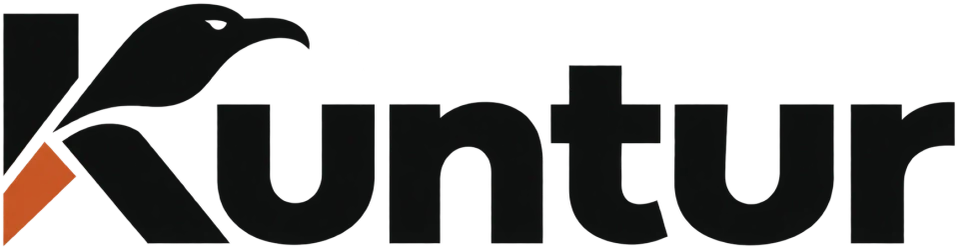

<picture>
  <source media="(prefers-color-scheme: dark)" srcset="assets/hero-dark.svg">
  <source media="(prefers-color-scheme: light)" srcset="assets/hero-light.svg">
  
</picture>

# Sebastián&nbsp;Cortez&nbsp;Silva

**Software&nbsp;Engineer** · Co-founder&nbsp;of&nbsp;Kuntur&nbsp;AI 
Products and intelligent solutions for the mining&nbsp;industry

*Whoever ends up using the product should feel the technology was truly designed for them.*

[LinkedIn](https://www.linkedin.com/in/sebasti%C3%A1n-cortez-silva-85345236b/) &nbsp;·&nbsp; [getkuntur.ai](https://getkuntur.ai) &nbsp;·&nbsp; Antofagasta, Chile

## Kuntur AI

<picture>
  <source media="(prefers-color-scheme: dark)" srcset="assets/kuntur-dark.webp">
  <source media="(prefers-color-scheme: light)" srcset="assets/kuntur-light.webp">
  
</picture>

<picture>
  <source media="(prefers-color-scheme: dark)" srcset="assets/work-kuntur-dark.svg">
  <source media="(prefers-color-scheme: light)" srcset="assets/work-kuntur-light.svg">
  
</picture>

Mining accreditation with agentic AI for contractor SMEs in the Antofagasta region. A company uploads its data and documents once, confirms the checklist for each contract, gets alerts before anything expires, and generates its work folder as a ZIP with an index. The agent does the paperwork; a person always approves conformity. I co-founded it and build it.

`Next.js` `Supabase` `PostgreSQL` `Agentic AI` `RAG`

## Hackathons

### 🥇 NASA Space Apps Challenge 2026 · Fireguard

<picture>
  <source media="(prefers-color-scheme: dark)" srcset="assets/work-fireguard-dark.svg">
  <source media="(prefers-color-scheme: light)" srcset="assets/work-fireguard-light.svg">
  
</picture>

Challenge: harmonizing MODIS and VIIRS hotspots. Fireguard puts 26 years of NASA FIRMS hotspots for Chile and Argentina on one VIIRS-equivalent scale, builds a burn calendar for any region and period, and shows where fire activity is most likely the next day, with the reason for each alert. On 2023–2025 data never seen in training, it catches 78–79% of the cell-days with a hotspot. [Repo](https://github.com/sxbast1anCZ/NASA-Space-Apps-2026)

`FastAPI` `DuckDB` `React` `MapLibre` `deck.gl` `NASA FIRMS`

### 🥇 Hackadisc 2026 · Insecap

<picture>
  <source media="(prefers-color-scheme: dark)" srcset="assets/work-hackadisc-dark.svg">
  <source media="(prefers-color-scheme: light)" srcset="assets/work-hackadisc-light.svg">
  
</picture>

A commercial dashboard for Insecap with a management view and a view for each sales executive: sales, quotes, client risk and late payments in one screen per role, fed by four machine learning models that run offline. [Backend](https://github.com/sxbast1anCZ/Hackadisc-back-26) · [Frontend](https://github.com/sxbast1anCZ/Hackadisc-front-26)

`FastAPI` `pandas` `SQLite` `Next.js` `React` `Machine Learning`

### 🥉 Hackamine 2026 · Case 3, uncrushables on conveyor belts

<picture>
  <source media="(prefers-color-scheme: dark)" srcset="assets/work-hackamine-dark.svg">
  <source media="(prefers-color-scheme: light)" srcset="assets/work-hackamine-light.svg">
  
</picture>

Three days solving real mining cases in multidisciplinary teams, run by BHP with Consorcio HEUMA, ChileGlobal Ventures and Fundación Minera Escondida. Our case (Intellegere): a camera over the belt that measures granulometry and warns about steel and uncrushable pieces before they reach the SAG mill. We scored 77.5 of 90 on the official evaluator, against 21.8 for the kit's example. In simulation, pieces reaching the equipment dropped from 7 to 1.

`Python` `PyTorch` `Computer Vision` `RunPod`

### Earlier

- 🥇 **NASA Space Apps Challenge 2025 · Antofagasta.** Air quality monitoring with NASA TEMPO satellite data and OpenAQ ground stations; awarded up to $600,000 in NVIDIA Cloud credits. [Repo](https://github.com/sxbast1anCZ/NasaSpaceApps2025-Back-end)
- 🥈 **Hackadisc 2025.** Financial reports and statistics backend for Insecap. [Repo](https://github.com/Deiviidsito/hackadisc-backend)
